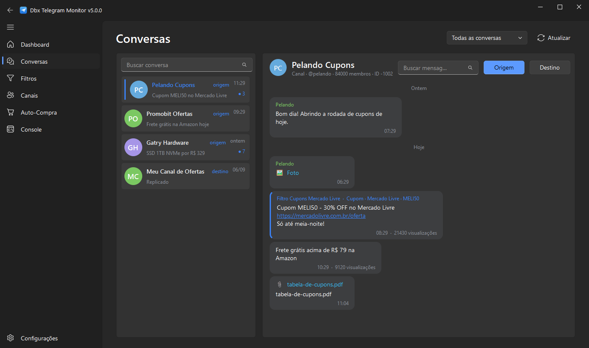

# Telegram Watcher

Monitor e replicador de mensagens do Telegram com interface desktop moderna. Captura mensagens de vários canais ou grupos, aplica filtros inteligentes e replica em tempo real para os destinos que você escolher.

[](https://github.com/vinibotelho1998/Telegram-Watcher/actions/workflows/build.yml)


## Destaques

- Interface Fluent Design para Linux e Windows, construída com PyQt6 e QFluentWidgets.
- Leitor de conversas embutido: navegue pelos seus canais e leia o histórico em balões, como no Telegram, sem sair do app.
- Replicação em tempo real preservando a mensagem original, com encaminhamento nativo e cópia automática como alternativa.
- Filtros inteligentes que detectam cupons, frete grátis, cashback, descontos e lojas sem precisar cadastrar cada código.
- Filtros por palavra com lógica de inclusão e exclusão, suporte a junção obrigatória com `+` e alternativas com `ou`.
- Dashboard com métricas ao vivo, gráfico de atividade por hora e histórico das últimas capturas.
- Compra automática (BETA) na KaBuM, Amazon e Terabyte: configure produtos, palavras e preço máximo, e o robô compra sozinho até gerar o PIX, aplicando cupom da mensagem e avisando no seu Telegram.
- Bandeja do sistema, inicialização ao entrar na sessão e início automático do monitor.
- Credenciais e sessões guardadas localmente, fora do controle de versão.

## Capturas de tela



| Filtros | Canais |
| :---: | :---: |
|  |  |

| Console | Configurações |
| :---: | :---: |
|  |  |

## Como funciona

Você marca canais de **origem** (monitorados) e de **destino** (para onde replicar). Cada mensagem nova nas origens passa pelos filtros ativos. Se algum filtro aprovar, a mensagem é replicada para os destinos daquele filtro ou para os destinos padrão.

Os filtros inteligentes analisam o texto e reconhecem padrões reais de oferta. Em vez de cadastrar `MELI50`, `PRAVC` ou `VALE100`, você ativa a regra `Qualquer cupom` e o detector captura qualquer código válido, com proteção contra falsos positivos.

## Conversas

A aba **Conversas** é um leitor de Telegram dentro do app. À esquerda ficam seus canais, grupos e conversas, com foto, prévia da última mensagem e contador de não lidas. À direita, a conversa escolhida em balões, agrupada por dia, com miniatura das fotos, links clicáveis e rolagem infinita para trás.

Duas coisas que o Telegram não faz: cada mensagem mostra **quais filtros seus a replicariam** e o que o detector encontrou nela (cupom, frete grátis, loja), então dá para testar um filtro contra mensagens reais antes de confiar nele. E dá para marcar o canal como Origem ou Destino sem sair da leitura.

Nada é enviado por essa tela: ela só lê. Mensagens novas aparecem sozinhas enquanto o monitor está online, e clicar em um evento do Dashboard abre a conversa correspondente.

## Stack

| Componente | Tecnologia |
| --- | --- |
| Linguagem | Python 3.10 ou superior |
| Interface | PyQt6 e QFluentWidgets |
| Telegram | Telethon |
| Loop assíncrono | qasync, integrando asyncio ao event loop do Qt |
| Configuração | python-dotenv |

## Linux

Nesta cópia, execute `./abrir.sh` para abrir a interface. Em uma instalação nova, rode
`./instalar-linux.sh` uma vez. Ele prepara o ambiente Python e instala o Chromium
usado pela automação opcional. O Chrome instalado via Flatpak também é detectado para
lojas que precisam do navegador do sistema.

O primeiro acesso abre o assistente de conta. Os dados ficam em
`$XDG_DATA_HOME/telegramwatcher` (padrão `~/.local/share/telegramwatcher`).
Quem já usava `~/.telegramwatcher` continua com essa pasta enquanto a nova estiver ausente.
A opção **Iniciar ao entrar no sistema** registra o aplicativo em XDG Autostart.

## Instalação no Windows

```bash
git clone https://github.com/vinibotelho1998/Telegram-Watcher.git
cd Telegram-Watcher

python -m venv .venv
.venv\Scripts\activate

pip install -r requirements.txt
python app.py
```

No Windows você também pode iniciar com um duplo clique em `ABRIR.bat`.

## CI e distribuição Linux

O workflow Linux roda a suíte e abre a janela com um perfil de teste no Ubuntu 24.04,
em pull requests, pushes na main e execuções manuais. Cada execução bem-sucedida
disponibiliza `Telegram-Watcher-linux.tar.gz` nos artefatos. Ao enviar uma tag
`vX.Y.Z`, o mesmo arquivo é anexado à release. Extraia o pacote e execute
`./instalar-linux.sh`, seguido de `./abrir.sh`. O pacote contém o código e os
lançadores. O instalador baixa as bibliotecas Python e o Chromium.

## Primeiros passos

1. Abra a aba **Configurações** e preencha:
   - **API ID** e **API Hash**, obtidos em [my.telegram.org](https://my.telegram.org).
   - **Telefone** com o código do país, por exemplo `+5511999999999`.
   - **Bot Token** é opcional, criado no [@BotFather](https://t.me/botfather).
2. Salve e clique em **Iniciar monitor** no Dashboard. Na primeira vez o Telegram envia um código de verificação, que você digita na janela que aparece.
3. Abra a aba **Canais**, clique em **Sincronizar** e marque cada canal como Origem ou Destino.
4. Em **Filtros**, crie um novo filtro com palavras ou detecção inteligente.
5. Abra **Conversas** para ler os canais dentro do app e conferir quais mensagens seus filtros pegariam.

## Compra automática (BETA)

> Funcionalidade em beta: teste bem antes de confiar em dinheiro real, e prefira o modo simulação até se acostumar com o fluxo.
>
> **Aviso legal:** a maioria das lojas proíbe automação em seus Termos de Serviço. Usar essa funcionalidade pode levar a suspensão de conta ou cancelamento de pedidos por parte da loja. O uso é por sua conta e risco — veja [TERMOS_DE_USO.txt](TERMOS_DE_USO.txt).

Suporta KaBuM, Amazon e Terabyte. Na aba **Auto-Compra** você configura tudo sem decorar sintaxe nenhuma. Cada produto vigiado tem três listas de palavras — as que **precisam aparecer**, as **alternativas** (basta uma) e as **proibidas** — montadas clicando, além de preço máximo, preço mínimo de segurança, quantidade e loja. Um campo de teste mostra na hora, em verde ou vermelho, se uma mensagem colada seria aceita e qual palavra bateu ou faltou.

Quando uma promoção capturada casa com um produto vigiado, o robô identifica a loja pelo link, valida o preço na página do produto, percorre o checkout, **seleciona PIX** e para na geração do código, que chega no app e nas suas Mensagens Salvas do Telegram com print e métricas por etapa. O pagamento é sempre seu: pague o PIX ou deixe expirar que o pedido cancela sozinho.

Garantias do robô, em qualquer loja:

- **O pagamento é sempre PIX.** Se a tela de revisão não confirmar PIX, ele não finaliza — importante na Amazon, cujo padrão é cartão de crédito.
- **Ele nunca paga.** Para no código PIX e entrega pra você.
- **Captcha não derruba a compra com o navegador visível:** o robô apita, traz a janela pra frente e espera você resolver, retomando sozinho depois. Com **Mostrar o navegador** desligado não há janela para resolver, então a compra para na hora e o aviso explica o motivo.
- **Vigia de sessão:** de tempos em tempos ele confere se a conta da loja continua conectada e avisa com som e Telegram se cair.

O botão **Testar o fluxo de compra** roda tudo isso sob demanda com um produto que você escolher, em três níveis: só consultar preço, simulação até a revisão, ou ir até gerar o PIX.

Para conectar uma conta, use **Conectar conta** na aba, ou:

```bash
python scripts/autobuy_login.py kabum
python scripts/autobuy_login.py amazon
python scripts/autobuy_login.py terabyte
```

Requer o Playwright:

```bash
pip install -r requirements-autobuy.txt
playwright install chromium
```

## Testes

```bash
pip install -r requirements-dev.txt
python -m pytest tests/ -q
```

Os testes cobrem o núcleo sem depender de rede: modelos, configuração, detector de cupons, correspondência de palavras, roteamento de filtros, o motor com eventos simulados e o roteamento de lojas da auto-compra.

## Gerar executável

```bash
pip install pyinstaller
pyinstaller TelegramWatcher.spec
```

O executável é gerado em `dist`.

## Estrutura do projeto

```
Telegram-Watcher/
├── app.py                 Ponto de entrada, bootstrap do Qt e do asyncio
├── watcher/               Núcleo independente da interface
│   ├── config.py          Credenciais e preferências
│   ├── models.py          Filtros, canais, métricas e estados
│   ├── storage.py         Persistência em JSON
│   ├── matching.py        Normalização e correspondência de palavras
│   ├── detector.py        Detector de cupons e ofertas
│   ├── filtering.py       Decisão de roteamento das mensagens
│   ├── reader.py          Leitura de conversas, histórico, busca e mídia
│   ├── engine.py          Motor assíncrono de monitoramento
│   └── autobuy/           Compra automática: registry de lojas, drivers e checkout
├── ui/                    Interface PyQt6
│   ├── window.py          Janela principal e orquestração
│   ├── pages/             Dashboard, Conversas, Filtros, Canais, Auto-Compra, Console, Configurações
│   ├── dialogs.py         Diálogos de login e edição de filtro
│   ├── widgets.py         Componentes visuais
│   └── theme.py           Cores e tema
├── scripts/               Utilitários de linha de comando (login, ícone, screenshots)
└── tests/                 Testes automatizados
```

## Privacidade e segurança

- As credenciais ficam em um arquivo `.env` na pasta de dados do aplicativo (no Windows, `%APPDATA%\TelegramWatcher`; no Linux, veja a seção Linux), nunca no repositório.
- As sessões do Telegram são salvas localmente e estão no `.gitignore`.
- A aba Conversas é somente leitura: o app nunca envia, apaga ou marca mensagens como lidas por você. Fotos e avatares baixados ficam em cache na subpasta `media/` dos dados do aplicativo.
- Nada é enviado para servidores de terceiros. A comunicação acontece direto com a API do Telegram.

## Documentação técnica

Arquitetura, convenções e decisões de design estão em [ARQUITETURA.md](ARQUITETURA.md).

## Licença

Distribuído sob a [GNU General Public License v3.0](LICENSE).

A interface é construída com PyQt6 e PyQt6-Fluent-Widgets, ambos GPLv3, e a GPL é
copyleft: qualquer trabalho combinado com eles sai sob a mesma licença. Por isso este
projeto é GPLv3 e não MIT, ao contrário dos outros que uso com PySide6. O
[NOTICE.md](NOTICE.md) detalha cada dependência.

Desenvolvido por Vinicius Botelho.
