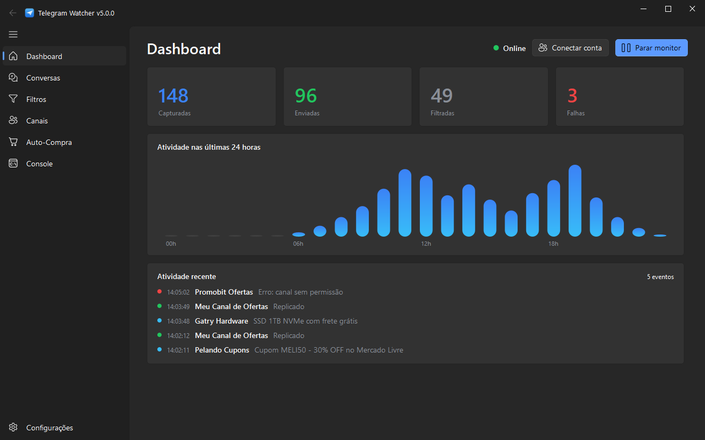
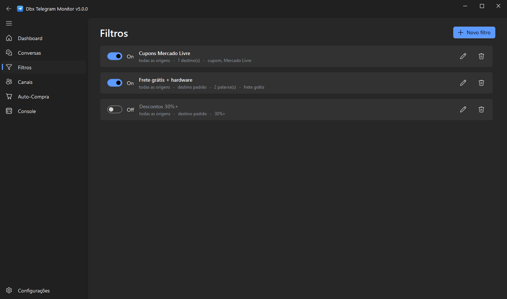
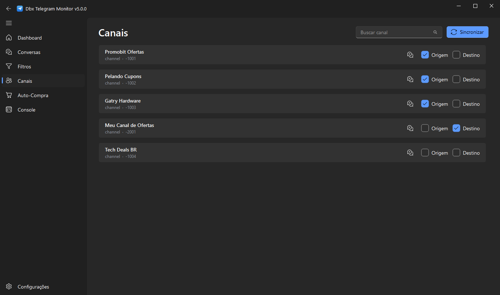
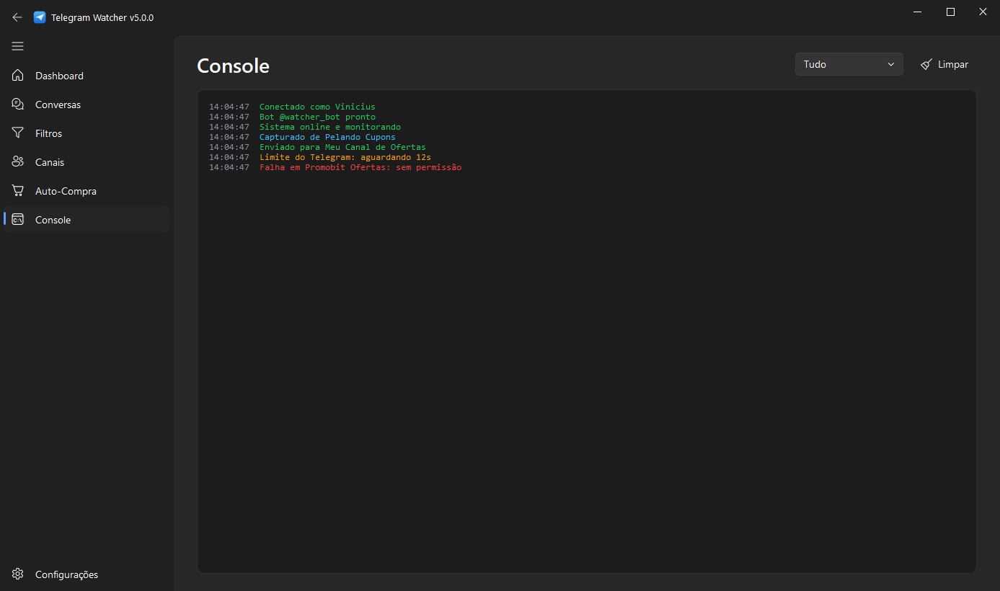
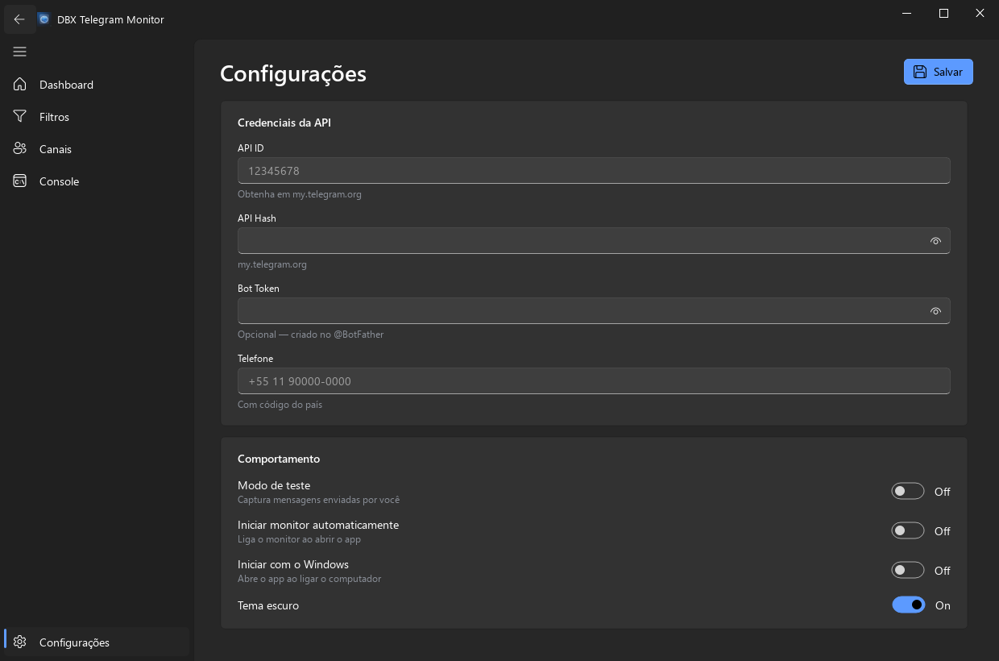

# DBX Telegram Monitor

Monitor e replicador de mensagens do Telegram com interface desktop moderna. Captura mensagens de vários canais ou grupos, aplica filtros inteligentes e replica em tempo real para os destinos que você escolher.




## Destaques

- Interface Fluent Design escura, fluida e nativa do Windows 11, construída com PyQt6 e QFluentWidgets.
- Replicação em tempo real preservando a mensagem original, com encaminhamento nativo e cópia automática como alternativa.
- Filtros inteligentes que detectam cupons, frete grátis, cashback, descontos e lojas sem precisar cadastrar cada código.
- Filtros por palavra com lógica de inclusão e exclusão, suporte a junção obrigatória com `+` e alternativas com `ou`.
- Dashboard com métricas ao vivo, gráfico de atividade por hora e histórico das últimas capturas.
- Compra automática (BETA) na KaBuM, Amazon e Terabyte: configure produtos, palavras e preço máximo, e o robô compra sozinho até gerar o PIX, aplicando cupom da mensagem e avisando no seu Telegram.
- Bandeja do sistema, inicialização junto com o Windows e início automático do monitor.
- Credenciais e sessões guardadas localmente, fora do controle de versão.

## Capturas de tela

| Filtros | Canais |
| :---: | :---: |
|  |  |

| Console | Configurações |
| :---: | :---: |
|  |  |

## Como funciona

Você marca canais de **origem** (monitorados) e de **destino** (para onde replicar). Cada mensagem nova nas origens passa pelos filtros ativos. Se algum filtro aprovar, a mensagem é replicada para os destinos daquele filtro ou para os destinos padrão.

Os filtros inteligentes analisam o texto e reconhecem padrões reais de oferta. Em vez de cadastrar `MELI50`, `PRAVC` ou `VALE100`, você ativa a regra `Qualquer cupom` e o detector captura qualquer código válido, com proteção contra falsos positivos.

## Stack

| Componente | Tecnologia |
| --- | --- |
| Linguagem | Python 3.10 ou superior |
| Interface | PyQt6 e QFluentWidgets |
| Telegram | Telethon |
| Loop assíncrono | qasync, integrando asyncio ao event loop do Qt |
| Configuração | python-dotenv |

## Instalação

```bash
git clone https://github.com/vinibotelho1998/Dbx-Telegram-Monitor.git
cd Dbx-Telegram-Monitor

python -m venv .venv
.venv\Scripts\activate

pip install -r requirements.txt
python app.py
```

No Windows você também pode iniciar com um duplo clique em `ABRIR.bat`.

## Primeiros passos

1. Abra a aba **Configurações** e preencha:
   - **API ID** e **API Hash**, obtidos em [my.telegram.org](https://my.telegram.org).
   - **Telefone** com o código do país, por exemplo `+5511999999999`.
   - **Bot Token** é opcional, criado no [@BotFather](https://t.me/botfather).
2. Salve e clique em **Iniciar monitor** no Dashboard. Na primeira vez o Telegram envia um código de verificação, que você digita na janela que aparece.
3. Abra a aba **Canais**, clique em **Sincronizar** e marque cada canal como Origem ou Destino.
4. Em **Filtros**, crie um novo filtro com palavras ou detecção inteligente.

## Compra automática (BETA)

> Funcionalidade em beta: teste bem antes de confiar em dinheiro real, e prefira o modo simulação até se acostumar com o fluxo.

Suporta KaBuM, Amazon e Terabyte. Na aba **Auto-Compra** você configura tudo sem decorar sintaxe nenhuma. Cada produto vigiado tem três listas de palavras — as que **precisam aparecer**, as **alternativas** (basta uma) e as **proibidas** — montadas clicando, além de preço máximo, preço mínimo de segurança, quantidade e loja. Um campo de teste mostra na hora, em verde ou vermelho, se uma mensagem colada seria aceita e qual palavra bateu ou faltou.

Quando uma promoção capturada casa com um produto vigiado, o robô identifica a loja pelo link, valida o preço na página do produto, percorre o checkout, **seleciona PIX** e para na geração do código, que chega no app e nas suas Mensagens Salvas do Telegram com print e métricas por etapa. O pagamento é sempre seu: pague o PIX ou deixe expirar que o pedido cancela sozinho.

Garantias do robô, em qualquer loja:

- **O pagamento é sempre PIX.** Se a tela de revisão não confirmar PIX, ele não finaliza — importante na Amazon, cujo padrão é cartão de crédito.
- **Ele nunca paga.** Para no código PIX e entrega pra você.
- **Captcha não derruba a compra:** o robô apita, traz a janela pra frente e espera você resolver, retomando sozinho depois.
- **Vigia de sessão:** de tempos em tempos ele confere se a conta da loja continua conectada e avisa com som e Telegram se cair.

O botão **Testar o fluxo de compra** roda tudo isso sob demanda com um produto que você escolher, em três níveis: só consultar preço, simulação até a revisão, ou ir até gerar o PIX.

Para conectar uma conta, use **Conectar conta** na aba, ou:

```bash
python scripts/autobuy_login.py kabum
python scripts/autobuy_login.py amazon
python scripts/autobuy_login.py terabyte
```

Requer o Playwright:

```bash
pip install -r requirements-autobuy.txt
playwright install chromium
```

## Gerar executável

```bash
pip install pyinstaller
pyinstaller DBXTelegramMonitor.spec
```

O executável é gerado em `dist`.

## Estrutura do projeto

```
Dbx-Telegram-Monitor/
├── app.py                 Ponto de entrada, bootstrap do Qt e do asyncio
├── monitor/               Núcleo independente da interface
│   ├── config.py          Credenciais e preferências
│   ├── models.py          Filtros, canais, métricas e estados
│   ├── storage.py         Persistência em JSON
│   ├── matching.py        Normalização e correspondência de palavras
│   ├── detector.py        Detector de cupons e ofertas
│   ├── filtering.py       Decisão de roteamento das mensagens
│   ├── engine.py          Motor assíncrono de monitoramento
│   └── autobuy/           Compra automática: registry de lojas, drivers e checkout
├── ui/                    Interface PyQt6
│   ├── window.py          Janela principal e orquestração
│   ├── pages/             Dashboard, Filtros, Canais, Auto-Compra, Console, Configurações
│   ├── dialogs.py         Diálogos de login e edição de filtro
│   ├── widgets.py         Componentes visuais
│   └── theme.py           Cores e tema
├── scripts/               Utilitários de linha de comando (login, ícone, screenshots)
└── tests/                 Testes automatizados
```

## Privacidade e segurança

- As credenciais ficam em um arquivo `.env` dentro de `%APPDATA%\DbxTelegramMonitor`, nunca no repositório.
- As sessões do Telegram são salvas localmente e estão no `.gitignore`.
- Nada é enviado para servidores de terceiros. A comunicação acontece direto com a API do Telegram.

## Licença

Distribuído sob a licença MIT.

Desenvolvido por DBX.
